> **قرار الواجهات المعتمد:** الصفحة `/` موقع تعريفي عام، وإدارة المنصة على `/admin` في الويب فقط؛ Flutter يخدم الموظف والشيف والمندوب. اقرأ [برومبت ربط Flutter بالحقول الفعلية](MOBILE_AGENT_PROMPT.ar.md) و[عقد التنفيذ](docs/WEB_MOBILE_INTEGRATION.ar.md).

# 🤝 وثيقة التعاون والمزامنة المشتركة بين تطبيق الموبايل ولوحة تحكم الويب
## مشروع: طلبات الحي الحكومي بالعاصمة الإدارية (Capital Talabat)

> **تحديث تنفيذ الويب — ٢١ أكتوبر ٢٠٢٦:** شاشة المطبخ ومركز العمليات والرفع إلى R2 ودورة `ready` منفذة في فرع `feature/real-orders-auth-maps`. اقرأ [عقد التنفيذ الآمن وخطوات ربط Flutter](docs/WEB_MOBILE_INTEGRATION.ar.md) قبل النشر. الملف أدناه يصف التصميم الأصلي؛ الموبايل الحالي لا يزال يستخدم حالة محلية ودخولًا تجريبيًا، ولم يُعتمد كتطبيق تشغيل متزامن. لا تمنح صلاحيات بقراءة حقل `role` القابل للتعديل، ولا تنشئ رصيدًا وهميًا. إنشاء الطلبات والتسليم بالرمز يتمان عبر الخادم.

> **موجهة إلى:** مطور / وكيل لوحة التحكم الويب (Web Dashboard Agent)  
> **من قِبل:** مطور / وكيل تطبيق الموبايل Flutter (Mobile App Agent)  
> **الهدف:** توحيد بيئة العمل وقاعدة البيانات السحابية (Firebase Firestore) ليعمل تطبيق الموبايل ولوحة تحكم الويب كنظام واحد متزامن لحظياً.

---

## 🏛️ 1. هيكل المستودع المشترك (Monorepo Structure)

المشروع الآن مقسم بشكل منظم داخل مستودع GitHub (`Moh-saudi/capital-talabat`):
```text
capital-talabat/
├── src/                        # 💻 كود لوحة تحكم الويب والموقع (React + Vite + Tailwind)
│   ├── components/             # واجهات الإدارة والمطبخ والتتبع
│   ├── data/                   # بيانات المطاعم والوزارات المبدئية
│   └── ...
│
├── mobile_app/                 # 📱 كود تطبيق الموبايل الرسمي (Flutter Native - Android & iOS)
│   ├── lib/
│   │   ├── core/               # الألوان وهوية العاصمة والخدمات
│   │   ├── models/             # نماذج البيانات المتوافقة مع Firestore
│   │   ├── providers/          # إدارة الحالة (State Management)
│   │   └── screens/            # شاشات Splash, Onboarding, وبوابات الأدوار الـ 4
│   └── android/app/google-services.json # ملف ربط Firebase الرسمي
│
├── SHARED_INTEGRATION_SPEC.md  # 📜 هذه الوثيقة (العقد البرمجي المشترك)
└── firestore.rules             # 🛡️ قواعد أمان قاعدة البيانات المشتركة
```

---

## 🔥 2. إعدادات Firebase الموحدة (Shared Firebase Project)

كلا النظامين (الويب والموبايل) مرتبطان **بنفس مشروع Firebase**:
- **Project ID:** `capital-talabat`
- **Project Number:** `462331103510`
- **Auth Domain:** `capital-talabat.firebaseapp.com`
- **Storage Bucket:** `capital-talabat.firebasestorage.app`
- **Web App ID:** `1:462331103510:web:b48e42c27667fcdee9e837`
- **Android App ID:** `1:462331103510:android:bbcec7992b9a9b08e9e837`
- **Android Package Name:** `eg.gov.capital.capital_talabat_app`

---

## ☁️ 3. سحابة تخزين الصور والوسائط (Cloudflare R2 Object Storage)

يتم تخزين وإدارة جميع ملفات الصور (صور الوجبات، قوائم الطعام، أغلفة المطاعم، صور الحسابات) عبر **Cloudflare R2** لسرعتها الفائقة وانعدام تكاليف خروج البيانات (Zero Egress Fees):

- **Bucket Name:** `capitaltalabat`
- **Account ID:** `14521cdfec73fa908fbf7e760fae362a`
- **Region / Location:** `Eastern Europe (EEUR)`
- **S3 API Endpoint:**  
  `https://14521cdfec73fa908fbf7e760fae362a.r2.cloudflarestorage.com/capitaltalabat`
- **Storage Class:** `Standard`
- **طريقة الاستخدام المشتركة:**
  - **من لوحة تحكم الويب:** عند إضافة أو تعديل مطعم أو وجبة جديدة في الفود كورت، يتم رفع الصورة إلى الـ Bucket عبر S3 API SDK / Presigned URLs ثم حفظ رابط الصورة الناتج `imageUrl` داخل مستند المطعم أو الوجبة في Firestore.
  - **من تطبيق الموبايل:** يقوم التطبيق بعرض الصور مباشرة عبر الروابط المحفوظة باستخدام `CachedNetworkImage` مع دعم التخزين المؤقت في ذاكرة الهاتف.

---

## 🗄️ 4. مخطط قاعدة البيانات المشترك (Shared Firestore Collections)

يجب الالتزام بأسماء الحقول والأنواع البرمجية التالية لضمان التزامن اللحظي بين شاشات الويب وشاشات الموبايل:

### 👤 أ. مجموعة المستخدمين: `/users/{userId}`
```typescript
interface UserProfile {
  uid: string;              // معرف الحساب
  fullName: string;         // الاسم بالكامل
  email: string;            // البريد الإلكتروني
  phone: string;            // رقم الهاتف
  ministry: string;         // اسم الوزارة (مثال: 'وزارة الاتصالات وتكنولوجيا المعلومات')
  floorNumber: string;      // الدور (مثال: 'الدور الرابع')
  roomNumber: string;       // رقم المكتب (مثال: 'مكتب 402')
  role: 'employee' | 'restaurant' | 'courier' | 'admin'; // الدور
  walletBalance: number;    // يبدأ بصفر؛ لا يضاف رصيد مالي دون عملية حقيقية موثقة
  createdAt: Timestamp;     // تاريخ التسجيل
  updatedAt: Timestamp;     // تاريخ آخر تعديل
}
```

---

### 📦 ب. مجموعة الطلبات الحية: `/orders/{orderId}`
```typescript
interface OrderRecord {
  orderNumber: string;       // رقم الطلب الظاهر (مثال: 'ORD-9421')
  profileId: string;         // معرف حساب الموظف
  profileName: string;       // اسم الموظف
  phone: string;             // رقم الهاتف
  ministry: string;          // الوزارة المستهدفة
  floorNumber: string;       // الدور
  roomNumber: string;        // رقم الغرفة/المكتب
  restaurantName: string;    // اسم المطعم أو مطبخ الفود كورت
  itemsSummary: string;      // ملخص الوجبات (مثال: 'ساندوتش تشيكن (×2)، لاتيه (×1)')
  subtotal: number;          // مجموع أسعار الوجبات
  deliveryFee: number;       // رسوم التوصيل لمكتب الوزارة (15 ج.م)
  discount: number;          // قيمة الخصم المطبق (مثل قسيمة 100 ج.م)
  total: number;             // المبلغ النهائي المطلوب تحصيله
  paymentMethod: 'cash' | 'instapay' | 'geidea';
  orderStatus: 'received' | 'preparing' | 'ready' | 'with_courier' | 'delivered' | 'cancelled';
  // otpCode لا يحفظ في هذا المستند المشترك؛ يُطلب من API بواسطة صاحب الطلب فقط.
  createdAt: Timestamp;      // وقت الطلب
  updatedAt: Timestamp;      // وقت تحديث الحالة
}
```

---

## 🔄 5. دورة حياة الطلب والتنسيق بين شاشات الويب وتطبيق الموبايل

```mermaid
graph LR
    A[📱 الموظف يطلب من تطبيق الموبايل] -->|orderStatus: received| B[💻 يظهر فوراً في لوحة تحكم المطبخ بالويب]
    B -->|orderStatus: preparing| C[💻 أو 📱 الشيف يبدأ الطهي]
    C -->|orderStatus: ready| D[🛵 إشعار المناديب للاستلام بالفود كورت]
    D -->|orderStatus: with_courier| E[🛵 المندوب في الطريق لمقر الوزارة]
    E -->|إدخال رمز OTP المكون من 4 أرقام| F[✅ orderStatus: delivered]
```



1. **العميل / الموظف (Mobile/Web):**
   - يطلب إنشاء الطلب عبر `POST /api/orders`؛ الخادم يتحقق من الأسعار والهوية ثم يكتب `/orders`.
   - يتم توليد رمز تحقق `otpCode` يظهر فقط للموظف في شاشة التتبع.
2. **الشيف / المطعم (Web Dashboard):**
   - يستمع لـ `collection('orders').where('orderStatus', '==', 'received')`.
   - يضغط على زر *"بدء التحضير"* فتتغير الحالة تلقائياً إلى `preparing`.
   - عند الانتهاء يضغط *"جاهز للاستلام"* فتتغير إلى `ready`.
3. **المندوب (Mobile Courier Portal):**
   - يرى الطلبات الجاهزة (`ready`) ويستلمها لتتحول إلى `with_courier`.
   - عند الوصول للمكتب، يطلب من الموظف كود `otpCode` ويرسله إلى `POST /api/order-delivery`؛ الخادم يؤكد التسليم. التحديث المباشر إلى `delivered` ممنوع.
4. **إدارة الحي الحكومي (Admin Web Dashboard):**
   - شاشة عرض حية لمراقبة مؤشرات الأداء، حركة الطلبات عبر الـ 34 وزارة، وحالة المناديب والمطابخ.

---

## 🚀 6. حالة المشروع والجاهزية
- كود تطبيق الموبايل Flutter موجود بالكامل داخل المجلد:  
  📁 [`mobile_app/`](./mobile_app/)
- تم إعداد وتكوين حزم Firebase و Google Services مسبقاً.
- التحليل البرمجي لتطبيق الموبايل: `No issues found! (0 errors, 0 warnings)`.

## تحديث الكتالوج — 23 أكتوبر 2026

أصبحت الهوية في `catalogItems` وعرض التاجر في `merchantOffers` وإسقاط التطبيق في `products`. أضيف `showInApp` (افتراضي true للتوافق)، وكائن `promotion {title,occasion,startsAt,endsAt,couponCode,terms}` بتواريخ ISO UTC. استبعد `showInApp:false` من قائمة التطبيق ومن الطلب. مرّر `products/{offerId}.id` في السلة؛ لا تمرر معرف الهوية بدل عرض التاجر. لا تقرأ الكتالوج الإداري الخاص مباشرة من عميل الهاتف.

الحملة لا تغيّر السعر بذاتها؛ الكوبون الحالي خصم على السلة بشروطه القائمة. لا تعتبر `hasPromotion/badge` وقت تحديث الإسقاط ساعةً حية؛ احسب نافذة `promotion` عند عرضها. تعديل نموذج Flutter والاشتراك موجود في هذا الفرع ويحتاج إعادة بناء التطبيق. راجع [تفاصيل المراجعة وحدود التسعير والصور](docs/CATALOG_REVIEW_2026-10-23.ar.md).
